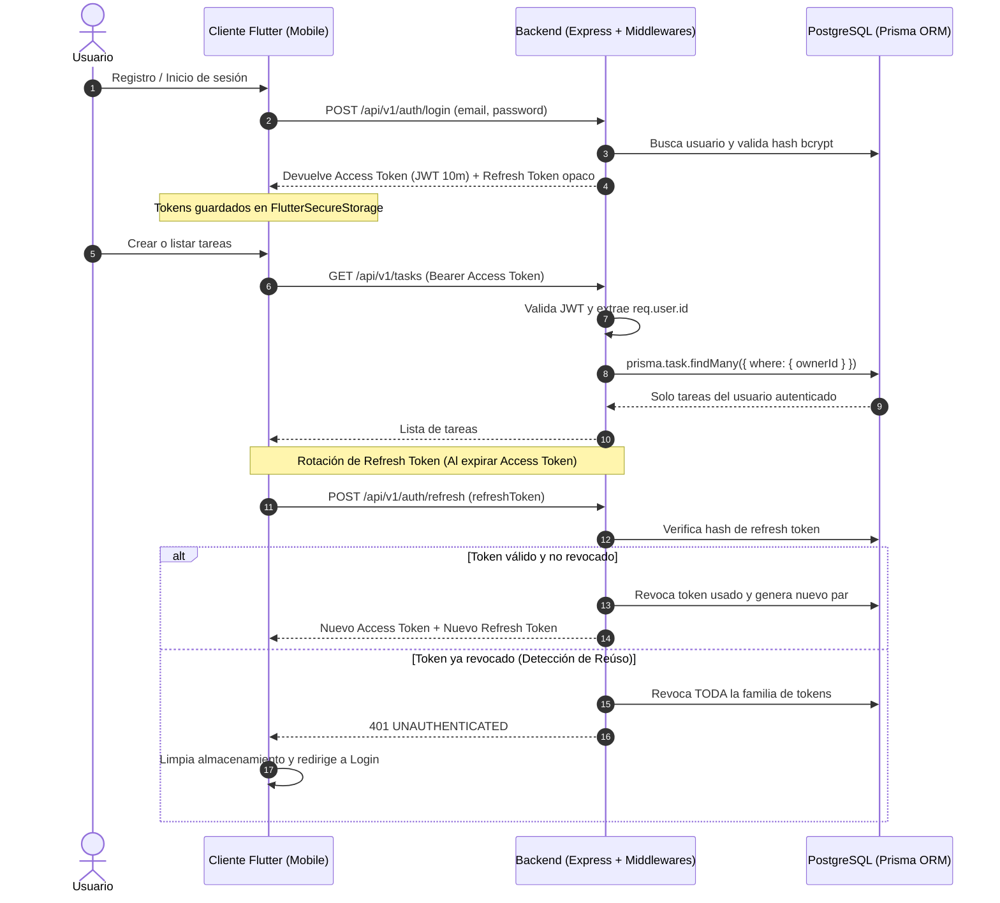

# Full-Stack Secure Task Manager (Flutter + Node.js)

Proyecto completo de gestión de tareas seguras (**Secure Task Manager**) desarrollado con **Flutter**, **Node.js (Express)**, **PostgreSQL** y **Prisma ORM**.

---

## 🏛 Arquitectura del Sistema



---

## 📂 Estructura del Repositorio

```text
guardian_api/
├── backend/
│   ├── compose.yaml                      # Configuración de Docker Compose para PostgreSQL
│   ├── prisma/
│   │   ├── schema.prisma                 # Modelos User, Task, RefreshToken con índices y cascades
│   │   └── migrations/                   # Migraciones versionadas
│   ├── src/
│   │   ├── app.js                        # Configuración de Express, Helmet, CORS, Rate Limit, Pino
│   │   ├── config.js                     # Validación Zod de variables de entorno (.env)
│   │   ├── server.js                     # Servidor HTTP con apagado ordenado (graceful shutdown)
│   │   ├── middleware/
│   │   │   ├── auth.middleware.js        # Verificación y decodificación de JWT Bearer
│   │   │   ├── error.middleware.js       # Manejo centralizado y seguro de errores
│   │   │   └── validate.middleware.js    # Validación de esquemas Zod (body, query, params)
│   │   ├── repositories/
│   │   │   ├── task.repository.js        # Operaciones Prisma aisladas por ownerId (Anti-IDOR)
│   │   │   └── refresh-token.repository.js # Gestión de tokens y revocación por familia
│   │   ├── routes/
│   │   │   ├── auth.routes.js            # Rutas de auth con limitadores de tasa (Rate Limiting)
│   │   │   └── task.routes.js            # Rutas CRUD de tareas protegidas
│   │   ├── schemas/
│   │   │   ├── auth.schema.js            # Esquemas de registro, login y refresh
│   │   │   └── task.schema.js            # Esquemas de creación, actualización y paginación
│   │   ├── services/
│   │   │   ├── auth.service.js           # Reglas de negocio de autenticación y rotación
│   │   │   └── task.service.js           # Reglas de negocio de tareas
│   │   └── utils/
│   │       └── tokens.js                 # Generación de JWTs y hashing criptográfico SHA-256
│   ├── tests/
│   │   ├── auth.test.js                  # Pruebas de integración del ciclo de vida de tokens
│   │   ├── health.test.js                # Prueba del endpoint de salud
│   │   └── tasks.test.js                 # Pruebas de límites de autorización entre usuarios A y B
│   ├── openapi.yaml                      # Especificación OpenAPI 3.0
│   └── verify_exercise.js                # Script automatizado de verificación de la actividad 19a
└── mobile/
    ├── lib/
    │   ├── main.dart                     # Entrada principal de la app con Riverpod ProviderScope
    │   ├── core/
    │   │   ├── config/app_config.dart    # Configuración de base URL según entorno
    │   │   ├── network/api_client.dart   # Cliente HTTP con refresco atómico y reintento único
    │   │   ├── storage/token_store.dart  # Persistencia segura con FlutterSecureStorage
    │   │   └── providers.dart            # Inyección de dependencias con Riverpod
    │   └── features/
    │       ├── auth/
    │       │   ├── data/auth_repository.dart
    │       │   └── presentation/auth_page.dart # Pantalla de Login y Registro
    │       └── tasks/
    │           ├── domain/task.dart            # Modelo de dominio de Tareas
    │           ├── data/task_repository.dart
    │           ├── presentation/task_controller.dart # Notifier de estado para tareas
    │           └── presentation/task_page.dart       # TaskListView (estados loading, empty, error, success)
    └── test/
        ├── api_client_test.dart          # Pruebas de cliente HTTP (refresh automático en 401)
        ├── task_list_view_test.dart      # Pruebas de widgets para los 4 estados de la UI
        └── fake_token_store.dart         # Mock de almacenamiento de tokens
```

---

## 🔒 Propiedades y Mecanismos de Seguridad Implementados

1. **Autorización a nivel de objeto (Anti-IDOR):** Cada consulta en el repositorio de tareas (`task.repository.js`) filtra explícitamente por `ownerId` obtenido del token verificado. No se confía en parámetros enviados por el cliente.
2. **Rotación de Refresh Tokens:** En cada petición de refresco, se invalida el token presentado y se genera uno nuevo.
3. **Detección de Reúso:** Si se presenta un token de refresco ya revocado, se revoca inmediatamente toda la familia de tokens del usuario.
4. **Almacenamiento Criptográfico Seguro:** Solo los resúmenes SHA-256 de los refresh tokens se almacenan en base de datos.
5. **Hash de contraseñas con bcrypt:** Contraseñas hasheadas con salt adecuado (costo 12) antes de persistirse.
6. **Tokens de acceso de vida corta:** Los tokens JWT expiran en 10 minutos.
7. **Rate Limiting:** Límites estrictos en rutas de autenticación (10 intentos por ventana de 15 minutos en login/registro).
8. **Manejo Seguro de Errores y Logs Estructurados:** Nunca se envían trazas de error, SQL o secretos en respuestas HTTP; Pino redacta contraseñas y tokens en consola.

---

## 📊 Evidencia de Cumplimiento (Hands-On Exercise 19a)

Resultados de la ejecución de pruebas y ejercicios de seguridad:

| Test | Expected status | Your result | Pass? |
| :--- | :---: | :---: | :---: |
| **Refresh with valid token** | 200 | 200 | **YES** |
| **Refresh with old token** | 401 | 401 | **YES** |
| **Refresh with newest token after reuse** | 401 | 401 | **YES** |
| **Refresh after logout** | 401 | 401 | **YES** |
| **Refresh after logout-all** | 401 | 401 | **YES** |

### Pruebas Unitarias y de Integración

- **Backend (Jest & Supertest):**
  - `health.test.js`: ✅ PASS (Endpoint de salud `/health`)
  - `auth.test.js`: ✅ PASS (Rotación, detección de reúso y revocación)
  - `tasks.test.js`: ✅ PASS (El Usuario A no puede acceder, modificar ni borrar tareas del Usuario B)
- **Frontend Flutter (`flutter test`):**
  - `api_client_test.dart`: ✅ PASS (Refresco automático en 401 y reintento único)
  - `task_list_view_test.dart`: ✅ PASS (Estados: cargando, lista vacía, error con reintento, listado y toggle)

---

## 💡 Preguntas de Reflexión (Sección 19a)

### 1. ¿Por qué rotar los tokens de refresco?
Permite reducir la ventana de oportunidad de un atacante si un token de refresco es interceptado o robado. Al invalidar el token anterior cada vez que se usa, un token sustraído solo servirá una vez, y si el usuario legítimo lo utiliza primero, el atacante fallará (o viceversa, detonando la detección de reúso).

### 2. ¿Qué podría suceder si el servidor almacenara los tokens de refresco en texto plano?
Si la base de datos sufriera una filtración (brecha de datos, inyección SQL o volcados de copia de seguridad no seguros), cualquier atacante con acceso a la base de datos obtendría tokens válidos directamente para suplantar la identidad de todos los usuarios sin necesidad de sus contraseñas. Guardar únicamente el hash SHA-256 garantiza que el atacante no pueda derivar el token original.

### 3. ¿Por qué el reúso de un token revoca a toda la familia de tokens?
Porque el intento de usar un token que ya fue rotado es un síntoma claro de que un tercero (o el cliente legítimo en una sesión interceptada) tiene una copia duplicada del token. Ante la duda de quién es la víctima y quién es el atacante, la política de máxima seguridad exige invalidar todas las sesiones derivadas de esa familia para forzar una nueva autenticación con contraseña.

### 4. ¿Cuál es el trade-off si un cliente legítimo reintenta un refresco tras un timeout de red?
Si el servidor procesó el refresco con éxito (rotó el token y guardó el nuevo hash), pero la respuesta HTTP no llegó al cliente debido a una caída de red momentánea, el cliente retendrá el token viejo. Al reintentar la solicitud con ese token viejo, el servidor lo detectará como un posible ataque de reúso e invalidará toda la familia, cerrando la sesión legítima del usuario. Para mitigar esto, los clientes deben implementar control de peticiones en vuelo único (*single-flight*) y timeouts balanceados.

---

## 🚀 Instrucciones para Levantar el Proyecto

### 1. Backend
```bash
cd backend
# Levantar PostgreSQL en Docker
docker compose up -d

# Configurar variables de entorno
cp .env.example .env

# Ejecutar migraciones de Prisma
npx prisma migrate dev

# Ejecutar pruebas automatizadas
npm test

# Iniciar servidor en desarrollo
npm run dev
```

### 2. Mobile (Flutter)
```bash
cd ../mobile

# Ejecutar pruebas unitarias y de widgets
flutter test

# Ejecutar la aplicación conectada a la API local
flutter run --dart-define=API_BASE_URL=http://10.0.2.2:3000/api/v1
```
*(Para pruebas en navegador web o escritorio local, utilice `--dart-define=API_BASE_URL=http://localhost:3000/api/v1`)*
